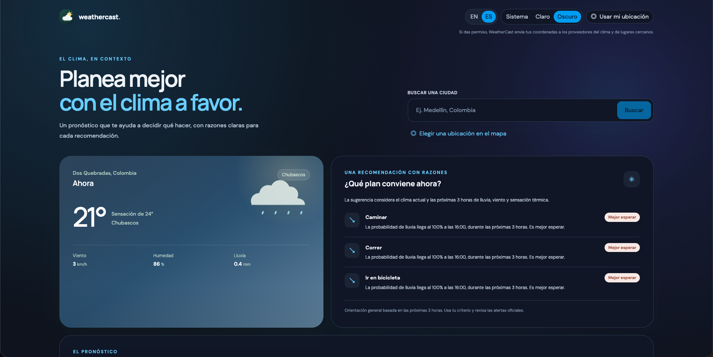
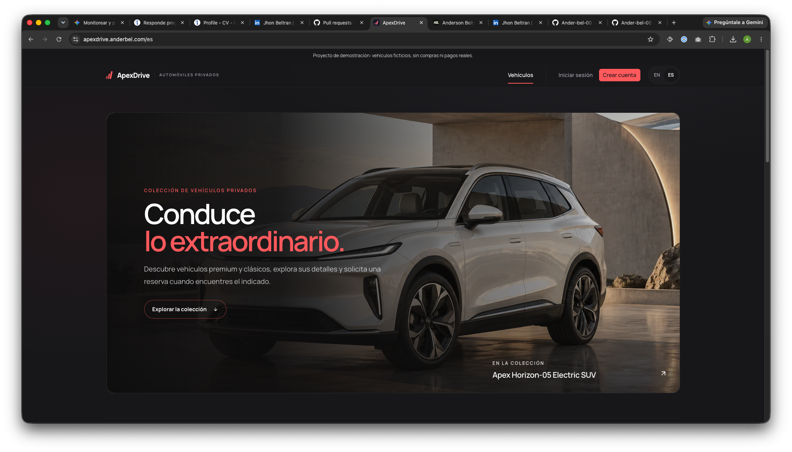

# Hi, I'm Anderson Beltrán

**Software developer focused on full-stack and backend development, with a background in QA automation.**

I build web applications and APIs, from the interface and business logic to testing and deployment. My experience in software quality helps me design reliable flows, investigate defects, and validate the products I build. I'm interested in software development opportunities and remain open to QA automation roles.

[Portfolio](https://anderbel.com/) · [LinkedIn](https://www.linkedin.com/in/jhon-beltran-3984a7337/) · [Email](mailto:jhonanderbel07@gmail.com)

## Selected projects

<table>
  <tr>
    <td width="50%">
      
      <h3>WeatherCast</h3>
      
A weather application with interactive maps, forecasts, and outdoor activity recommendations.

      
<strong>Nuxt · TypeScript · FastAPI · Python</strong>

      
<a href="https://weathercast.anderbel.com/">Live app</a> · <a href="https://github.com/Ander-bel-00/weathercast-outdoor">Repository</a>

    </td>
    <td width="50%">
      
      <h3>ApexDrive</h3>
      
A vehicle showcase and reservation demo with search filters, financing estimates, and inventory administration. Vehicles and reservations are fictional.

      
<strong>Nuxt · TypeScript · Laravel · PostgreSQL</strong>

      
<a href="https://apexdrive.anderbel.com/">Live demo</a>

    </td>
  </tr>
</table>

**[Órbita Neón](https://nytheragames.itch.io/orbita-neon)** — A browser-playable 2D space arcade game with waves, bosses, and multiple control options. Built with Godot 4, GDScript, and WebGL.

**Tu Ritmo** — An Android training prototype exploring weekly planning and a guided sample session. Built with Kotlin and Jetpack Compose; the illustrative content is still under review.

**NovaBank** — A banking API learning project with simulated accounts and transactions, built with Java, Spring Boot, PostgreSQL, and Flyway.

Explore the projects and their current status in my [portfolio](https://anderbel.com/#proyectos).

## Technologies and practices

- **Frontend:** JavaScript, TypeScript, Vue, Nuxt, React, Next.js, Tailwind CSS.
- **Backend and data:** PHP, Laravel, Node.js, Express, Python, FastAPI, Java, Spring Boot, PostgreSQL, REST APIs.
- **Quality:** Playwright, end-to-end and regression testing, test case design, and defect tracking.
- **Delivery and tools:** Git, GitHub Actions, Docker, Coolify, Linux, and Hetzner VPS.

I value clear interfaces, maintainable code, and testing that supports confident delivery.
